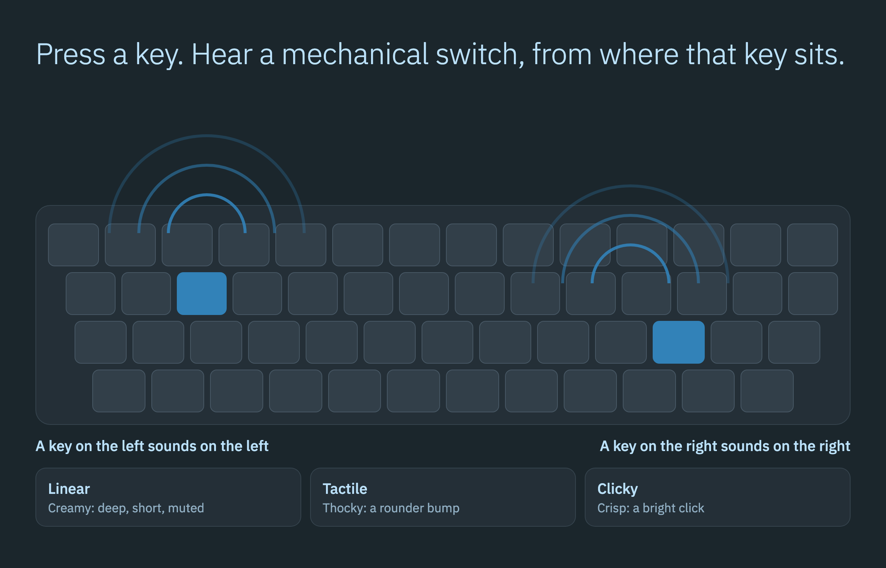
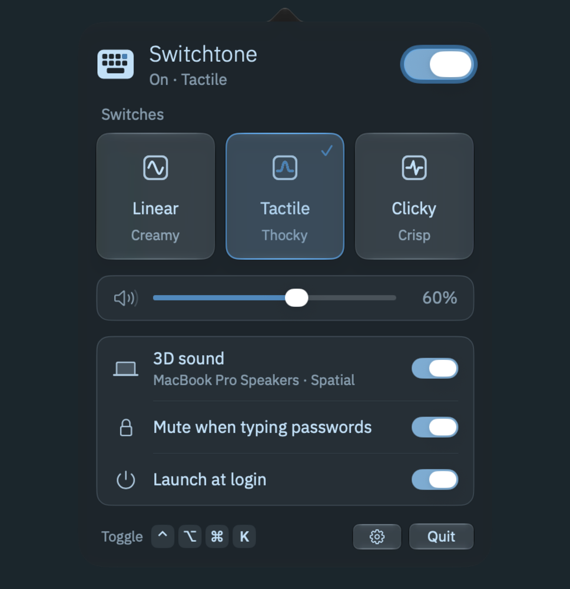
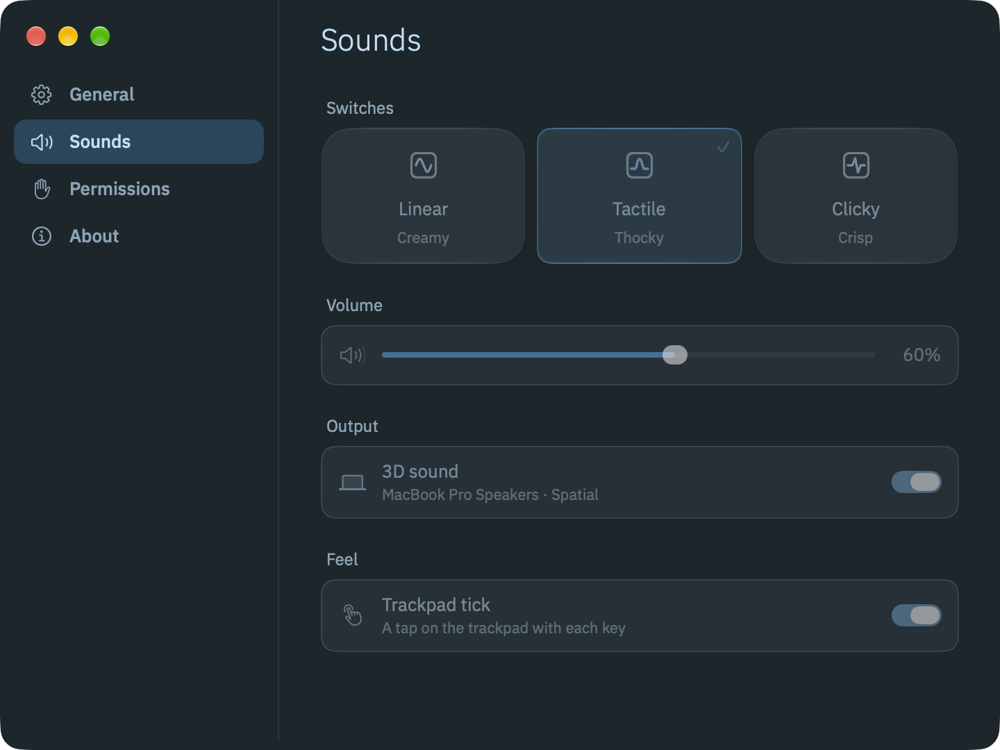

# Switchtone

[](https://github.com/gabrimatic/switchtone/releases/latest)
[](LICENSE)
[]()
[]()
[]()
[](#sound-credits)

**Real mechanical keyboard sounds for every key you press, placed in 3D where each key sits on your keyboard.**

Switchtone is a free, native menu bar app for anyone who wants the sound of a mechanical keyboard on a Mac. It plays a recorded press when a key goes down and a release when it comes back up, in every app. It has no network access, no analytics and no Dock icon.

[Website](https://gabrimatic.github.io/switchtone/) · [Download](https://github.com/gabrimatic/switchtone/releases/latest) · [Contributing](CONTRIBUTING.md) · [Security](SECURITY.md)

<p align="center">
  
</p>

## Install

One line. It downloads the latest release, checks its SHA-256 against `SHA256SUMS.txt`, installs to `/Applications` and opens Switchtone:

```bash
curl -fsSL https://raw.githubusercontent.com/gabrimatic/switchtone/main/install.sh | bash
```

To read it first: [install.sh](install.sh). Options: `--no-open`, `SWITCHTONE_VERSION=1.0.0`, `SWITCHTONE_INSTALL_DIR=$HOME/Applications`.

Or download `Switchtone-<version>.dmg` (or the `.zip`) from [Releases](https://github.com/gabrimatic/switchtone/releases/latest) and drag Switchtone to Applications.

### First Open

Switchtone is free and open source. Release builds are signed ad hoc, not notarized, so macOS blocks the first open of a copy you downloaded in a browser. `install.sh` does not hit this.

1. Open Switchtone. macOS says it cannot verify the app. Choose **Done**.
2. Open **System Settings > Privacy & Security** and scroll to **Security**.
3. Next to the note that Switchtone was blocked, click **Open Anyway** and confirm.

You do this once per download. Because the signature is ad hoc, macOS can treat a new version as a new app: if a permission stops working after an update, switch Switchtone off and on in that list.

## What It Does

Every key rings on its own from its own place, and the sounds overlap the way they do on a real board.

- **Three switch profiles**, cut from lossless recordings into 48 kHz, 24-bit stereo:
  - **Linear (creamy):** deep, short, muted.
  - **Tactile (thocky):** a rounder bump with a mid-range knock. The default.
  - **Clicky (crisp):** a bright click over a solid body.
- **3D sound.** Every key sounds from its own place on a MacBook keyboard, and the far right sits exactly as far right as the far left sits left. On speakers, each key has its own level in each channel and a short delay between them, so the stereo stage is as wide as the keyboard. On headphones and AirPods, Apple's high-quality HRTF rendering puts the keyboard half a meter in front of and below your ears, and AirPods with head tracking keep it in place when you turn. Turn 3D sound off for plain stereo.
- **It plays like a real board.**
  - Every hit rings the case under it, on its own low note, so a firm press has real weight.
  - Speed changes the touch. A slow press lands hard and rings out. At full speed a key is half as loud, darker and half as long, because fast fingers barely bottom out.
  - Each key has its own slight tuning.
  - Space, Return, Delete and Shift have a stabilizer rattle.
  - A release sounds when the spring has carried the keycap back up, a few milliseconds after you let go.
  - Holding a key down is silent after the first press, like a real switch.
  - A key released with no press heard stays silent.
- **A tick under your fingers.** Each press gives a tap on the Force Touch trackpad, ahead of the sound. Settings > Sounds > Trackpad tick, on by default.
- **Fast.** About 3 ms from the key event to the sound leaving Switchtone, measured on an M5 MacBook Pro. The output adds its own delay after that: see [Limits](#limits).
- **Quiet at rest.** After a minute without a key the audio output pauses, so the Mac can sleep and Switchtone sits at about 0% CPU. While the output runs it costs about 1 to 2% of one core. Waking the Mac, unlocking it or pressing any key starts it again, and so does a left click within two minutes of the last key, outside Low Power Mode. At volume 0, or while Switchtone is off, muted by a Focus or not allowed, the output stays off. Memory is about 25 MB on the speakers with the output running.
- **The panel** (click the menu bar symbol):
  - On/off switch, also **Control-Option-Command-K** from any app, or Option-click the menu bar symbol.
  - Profile cards that play a short phrase when you hover over them.
  - Volume, 3D sound with the current output, and Follow head movement on headphones.
  - Mute when typing passwords, Launch at login, a Settings button, Quit.
- **Mute when typing passwords** (on by default) skips every sound while macOS secure keyboard entry is on: a focused password field, Terminal's Secure Keyboard Entry and the like. macOS already hides keystrokes from all apps while it is on; this setting also keeps the modifier keys silent.
- **The menu bar icon is optional.** Settings > General > Show menu bar icon (on by default) takes it out of the bar when the bar is full, for example next to the notch. System Settings > Menu Bar can hide it too. Everything stays in Settings.
- **Windows.**
  - The welcome window shows on the first launch: what Switchtone does, the one permission it needs, Launch at login and Done. Done, Esc and the close button end it the same way, and it never returns on its own.
  - Settings has General, Sounds, Permissions and About panes. General holds the on/off switch, Launch at login and Show menu bar icon. Permissions shows the live status and a row to show the welcome window again. About has a Using Switchtone section.
  - The About window shows the version and the copyright.
  - While a Switchtone window is in front, the standard menus show: Switchtone, Edit, Window and Help. **Switchtone Help** opens Settings > About. There is no Dock icon in any state.
  - Opening Switchtone again from Finder or Spotlight shows the welcome window until it is finished, and Settings after that, so everything stays reachable when the menu bar symbol is hidden. Only one Switchtone runs at a time.
- **Shortcuts and Siri:** Toggle Switchtone Sounds, Turn Switchtone Sounds Off ("Mute Switchtone"), Turn Switchtone Sounds On ("Unmute Switchtone"), Set Switchtone Switches, Set Switchtone Volume.
- **Focus filter:** System Settings > Focus > (a Focus) > Focus Filters > Switchtone mutes the sounds while that Focus is on.
- **Control Center:** add the Switchtone switch to Control Center or the menu bar. It shows whether the sounds are on and turns them on or off.

<p align="center">
  
</p>

<p align="center">
  
</p>

## Requirements

- Apple silicon Mac.
- macOS 26 or later.
- The Input Monitoring permission.
- Optional: a Force Touch trackpad for the tick, and AirPods or Beats with head tracking for Follow head movement.

## Permissions

Switchtone needs one permission, **Input Monitoring**, to hear key presses. It reads only which key went down or up, to pick the sound and its place. The tap also receives left clicks, used only as a signal that you are about to type, so the output can start ahead of the first key; where you click and what you click is never read. Scrolls and the pointer's movement are not received.

1. The welcome window shows the permission with an **Allow…** button. It asks through the macOS prompt, so macOS adds Switchtone to the list itself and you never press "+". The row reads **Allowed** the moment you allow it, with no relaunch.
2. If you said no, the same button becomes **Open System Settings** and goes to **Privacy & Security > Input Monitoring**, where you turn on **Switchtone**. Settings > Permissions shows the same row at any time.

Until it is allowed, the menu bar symbol shows an exclamation mark and a notice in the panel opens that same pane. Switchtone notices the grant within about a second while System Settings is in front, and starts playing with no relaunch.

If the list shows Switchtone but it hears no keys, macOS holds that switch for a different signature: switch it off and on there. When keys are typed and none arrive, Switchtone relaunches itself once. If it still hears nothing, the panel asks for that off-and-on, and Switchtone relaunches again when you come back from System Settings.

If you hear nothing, check Settings > Permissions first, then the panel's state line: **Off**, **Not listening** (no permission), **Paused** (a Focus is muting it), **No sound** (no output device) and **Muted** (volume 0) each say why.

Switchtone asks for nothing else: no microphone, camera, screen recording, accessibility, location or network. **Launch at login** uses macOS Login Items and starts on. To turn it off, use the switch in the panel or in Settings > General, or System Settings > General > Login Items.

## Privacy

Everything stays on your Mac.

| What | Where it goes |
|------|---------------|
| Which key went down or up | Read in memory to pick a sound. Never characters, never stored, never logged |
| Left clicks | A signal to warm up the audio output. No position, no target |
| Sounds | Decoded from files inside the app |
| Settings | Switchtone's defaults domain, `info.gabrimatic.switchtone` |
| On/off state for the Control Center switch | `~/Library/Application Support/info.gabrimatic.switchtone/state.json` |
| Network | Not used. No analytics, no telemetry, no accounts, no update check |

The log carries counters only. Read it with `log stream --predicate 'subsystem == "info.gabrimatic.switchtone"' --info`. To write the counters on demand, run `kill -USR1 $(pgrep -x Switchtone)`. Details: [docs/PLATFORM.md](docs/PLATFORM.md).

## Limits

- Key positions assume a MacBook ANSI layout. Other layouts play the right sounds, with slightly different positions.
- Bluetooth output counts as headphones unless its name marks a speaker (speaker, soundbar, HomePod, TV and the like). Core Audio does not say whether a Bluetooth device is worn.
- Head tracking needs AirPods or Beats that support it. Elsewhere the keyboard stays fixed in front of you.
- No custom sound packs or per-app rules.
- **Delay on the built-in speakers.** macOS's own speaker processing holds every sound for 15.6 ms, at every sample rate, plus a 1 ms safety offset. Core Audio reports both and no app can skip them. On a MacBook's speakers a key takes about 20 ms to reach the air, and about 3 ms of that is Switchtone. Under 10 ms needs an output with a shorter path of its own.
- **The first press after a pause.** It restarts the output, which takes 35 to 70 ms on the built-in speakers. That press still plays if the output is ready within 120 ms, so it arrives up to about 70 ms late. On a slower output, such as some Bluetooth devices, it stays silent. Waking or unlocking the Mac warms the output ahead of the first key.
- **The trackpad tick uses a private framework.** There is no public API for a tick of this size, so Switchtone loads Apple's private `MultitouchSupport` framework at run time (`dlopen`) and calls `MTActuatorCreateFromDeviceID`, `MTActuatorOpen` and `MTActuatorActuate`. It checks that the functions and an actuator are there first. Without them there is no tick, Settings says what it needs, and nothing else changes. A macOS update can take it away at any time. The tick has one fixed strength. A private framework also rules out the Mac App Store, which Switchtone does not use.

Platform choices, measurements and what was left out on purpose are in [docs/PLATFORM.md](docs/PLATFORM.md). What must stay true is in [docs/SPEC.md](docs/SPEC.md).

## Build from Source

Requirements: Xcode 27 or later (Swift 6).

```bash
git clone https://github.com/gabrimatic/switchtone.git
cd switchtone
./build.sh --install
```

`scripts/package.sh` builds the release files into `dist/`. Details: [CONTRIBUTING.md](CONTRIBUTING.md).

## Uninstall

Quit Switchtone with the Quit button in the panel, or Command-Q while one of its windows is in front. Delete it from Applications, then remove its settings and its state file:

```bash
defaults delete info.gabrimatic.switchtone
rm -rf ~/Library/Application\ Support/info.gabrimatic.switchtone
```

The login item goes with the app. To clear the rest, select Switchtone in **Privacy & Security > Input Monitoring** and press the minus button, and remove the Switchtone switch from Control Center or the menu bar if you added it.

## Sound Credits

Both sources are lossless, and both licenses were checked on the source's own page. The samples in `Resources/Sounds` are edited from them.

| Profile | Source | Author | Format | License |
|---|---|---|---|---|
| Linear, Clicky | [Keyboard Sound Dataset](https://zenodo.org/records/16564409), red and blue switches | Sony Corporation | 44.1 kHz, 16-bit | MIT, Copyright 2020 Sony Corporation. The full notice ships in `Resources/Sounds/NOTICE.txt` and inside the app |
| Tactile | [typing.wav](https://commons.wikimedia.org/wiki/File:399603_dustin-davis_typing.wav) (also on [Freesound](https://freesound.org/people/Dustin_Davis/sounds/399603/)), a large-diaphragm condenser over a keyboard | Dustin_Davis | 44.1 kHz, 32-bit float | CC0 1.0 |

The windows, cards and labels Switchtone draws itself are set in [IBM Plex Sans](https://github.com/IBM/plex), Copyright © 2017 IBM Corp. with Reserved Font Name "Plex", under the SIL Open Font License 1.1. The license text is `Resources/Fonts/OFL.txt`, copied into the app with the font.

### How the Samples Were Made

`Resources/Sounds/<profile>/<family>-<down|up>-<n>.wav` holds 58 files per profile, in 48 kHz, 24-bit stereo. `scripts/make-sounds.swift` generates them once and they are committed; the build only copies them.

The script reads each recording as mono at 48 kHz and picks 16 clean strokes, spread from dark to bright. For each stroke it cuts the press and its release out of the recording, starting right on the hit, then adds:

- a minimum-phase voicing EQ, so nothing rings ahead of the transient,
- a body: three damped modes between 128 and 296 Hz, rung by the stroke's own hit, so the low end starts with the transient and leaves it untouched,
- stereo: short reflections from about 1.9 ms on, above 280 Hz, added to one channel and taken from the other, so the hit is the same in both and the channels sum back to the stroke,
- a tail that fades into silence, and one gain for a press and its release, so they keep their recorded balance.

Space, Return, Delete and the modifier keys use the same profile's strokes, pitched down: the bigger the key, the lower.

To regenerate them, put the two sources in one folder and run the script. With the same Xcode, a run reproduces the committed files to the byte.

```bash
mkdir sources && cd sources
curl -L -o dataset.zip https://zenodo.org/api/records/16564409/files/keyboard_sound_dataset.zip/content
unzip -q dataset.zip -d keyboard_sound_dataset
curl -L -o 399603-typing.wav https://upload.wikimedia.org/wikipedia/commons/4/4f/399603_dustin-davis_typing.wav
cd ..
swiftc -O scripts/make-sounds.swift -o make-sounds -framework AVFoundation -framework Accelerate
./make-sounds sources Resources/Sounds
./make-sounds --analyze Resources/Sounds     # spectrum, stereo and attack per profile
```

## Contributing

Bug reports, ideas and pull requests are welcome: [CONTRIBUTING.md](CONTRIBUTING.md). Everyone taking part follows the [Code of Conduct](CODE_OF_CONDUCT.md). Security reports go through [SECURITY.md](SECURITY.md).

## License

MIT. See [LICENSE](LICENSE).

## Trademarks

Apple, Mac, macOS, MacBook, AirPods, HomePod, Force Touch, Core Audio, Siri, Shortcuts, Spotlight, Finder, Terminal, Control Center, App Store, Xcode and Swift are trademarks of Apple Inc., Beats is a trademark of Beats Electronics LLC, Bluetooth is a registered trademark of Bluetooth SIG, Inc., and Sony, IBM, Plex, Zenodo, Wikimedia Commons, Freesound, GitHub and Buy Me a Coffee belong to their owners; Switchtone is independent and is not affiliated with or endorsed by any of them.

---

Created by [Soroush Yousefpour](https://gabrimatic.info)

[](https://www.buymeacoffee.com/gabrimatic)
